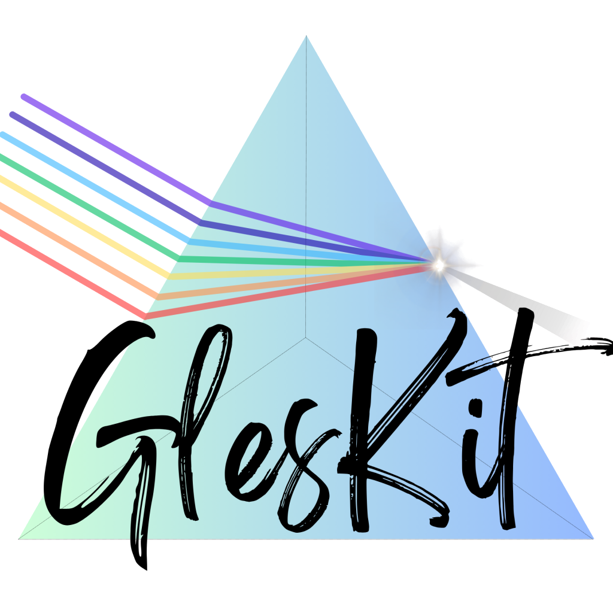
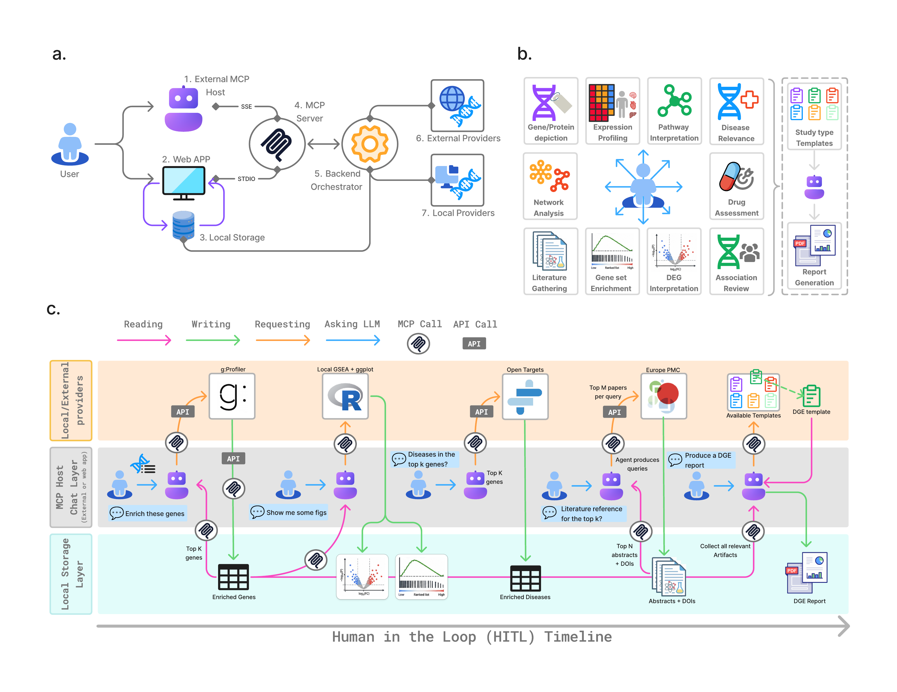

# GLESKit



**Gene-Level Evidence Synthesis Toolkit**

**Paper:** [GLESKit: an MCP-based system for gene-level biomedical investigation and evidence synthesis](https://www.biorxiv.org/content/10.64898/2026.10.25.761689v1)<br />
Athos Moraes and Pedro G. Ferreira. *bioRxiv*, 2026.

**Contents:** [Overview](#overview) | [Architecture](#system-architecture) | [Installation](#installation) | [Usage](#usage) | [MCP server](#mcp-server) | [Data](#data-and-configuration) | [Guides](#documentation) | [Development](#development) | [Citation](#citation) | [License](#license)

GLESKit is an integrated environment for **human-in-the-loop, gene-level biomedical
investigation**. It helps researchers connect gene-expression data with functional
annotations, pathways, interaction networks, genetic associations, drug-target
evidence and literature, and assemble these materials into a reviewable scientific
account.

An investigation can begin with raw RNA-seq counts, differential-expression
results, one or more genes, a biomedical question or a hypothesis. A conversational
agent coordinates established bioinformatics resources and local analyses through
the **Model Context Protocol (MCP)**; the researcher directs the investigation and
reviews its interpretations. Normalized gene identifiers connect results across
resources while preserving their sources, analytical context and evidence types.

The locally served web app adds optional study sessions that retain uploaded
data, analyses, evidence, figures, notes and template-guided reports as reusable
artifacts. These materials remain available for inspection, revision and further
synthesis beyond a single conversation. The shared MCP interface separates the
biomedical operations from the chosen language model or conversational client,
allowing the same service to be used through another compatible MCP client.

<br clear="right" />

## Overview

- **From data to interpretation:** inspect expression inputs, run DESeq2,
  interpret differential-expression results, perform enrichment or ranked GSEA,
  and explore matrices with statistics, PCA and clustering.
- **From genes to biological context:** connect gene/protein identity, tissue
  expression, pathways, interaction networks, disease and drug associations,
  and literature while retaining each result's source.
- **From evidence to a report:** use configurable templates for biomarker
  prioritization, mechanism interpretation or disease context, linking reports
  to the supporting analyses, figures and stored materials.
- **From one request to an evolving study:** reuse session-linked artifacts,
  add evidence, compare results and revise the synthesis. Web chat uses a private
  OpenCode runtime with GLESKit's authored instructions and task-specific skills.

See the [complete tool/provider map](docs/tools_providers.md).

The accompanying study evaluates focused computational-biology answers with a
gene-level subset of [BixBench](docs/bixbench_evaluation.md), and extended report
production with **GeneReportBench** (named [RepoBench](docs/repobench_evaluation.md)
in the code). Those benchmarks were automated; human-in-the-loop investigation
is the intended use, and evidence, calculations and conclusions require expert
review. The current focus is transcriptomic and gene-level investigation, with
the strongest demonstrated use in human biology.

## System architecture

[](docs/assets/gleskit-architecture.png)

**a. System layers:** a web app or external MCP client connects to the backend,
which coordinates local analyses, external evidence providers and local storage.
**b. Research capabilities:** gene-centered analyses and evidence gathering feed
template-guided reports. **c. Example investigation:** a researcher iteratively
requests enrichment, figures, disease context and literature, reusing the stored
results to produce a report. Click the figure to view its labels at full size.

The diagram presents the high-level design; see [MCP server](#mcp-server) for the
connection modes currently supported by this release.

## Installation

**Docker is required for the supported web-app installation.** Tested target:
Apple Silicon macOS with native Linux ARM64 containers. Other platforms and
emulation are not validated.

1. Install and start [Docker Desktop](https://www.docker.com/products/docker-desktop/)
   with Engine **28+** and Docker Compose.
2. Download or clone this repository; open a terminal in its root folder.
3. Run:

   ```sh
   sh scripts/docker_ui.sh open
   ```

First launch builds the pinned environment and can take **20 minutes or more**.
The final image is **about 6 GB**, excluding research data. Extra build/cache
space is needed; the first-build peak has not been measured. Host Python, R,
Node.js and OpenCode are not required.

| To do this | Command | Make alias |
| --- | --- | --- |
| Open or reuse the app | `sh scripts/docker_ui.sh open` | `make ui_docker` |
| Check status | `sh scripts/docker_ui.sh status` | `make status_ui_docker` |
| Stop the app and its children | `sh scripts/docker_ui.sh stop` | `make close_ui_docker` |

The helper opens an authenticated browser session on `127.0.0.1:8123`. Closing
its tab leaves analyses running; **stop** quits the app and preserves saved data.
See [backups, input mounts and rebuilds](docs/local-web.md).

## Usage

1. Open **Settings → Providers & models**. Add a provider/key, enable models and
   choose **Save & activate**. OpenRouter, OpenAI, Anthropic and explicitly
   configured OpenAI-compatible endpoints are supported.
2. In **Cohorts**, download a supported public cohort or import local data.
3. In **Chat**, select your model and ask for evidence, analysis or figures.
   For example: “Run PCA on the expression matrix I uploaded and generate a figure.”
4. In **Workspace**, create or select a session only when you want persistence.
   Launching or chatting never silently creates or activates a scientific session.

To continue saved work, reopen its session or chat thread. Provider settings,
keys and enabled models survive restarts. For specific tasks, use the
[web-app guide](docs/local-web.md#contents).

## MCP server

Standalone MCP currently uses **host Python 3.11+**. R-backed tools also need
host R/scientific packages; see [runtime versions](docs/runtime-baseline.md).
Node.js and OpenCode are not required for standalone MCP serving.

Install from the project root, then configure your client to launch the stdio command:

```sh
python3 -m venv .venv
.venv/bin/python -m pip install -e '.[mcp]'
.venv/bin/python -m gleskit_mcp --project-root . serve --transport stdio
```

Use absolute executable/project paths in client configuration. For a local HTTP client:

```sh
.venv/bin/python -m gleskit_mcp --project-root . serve \
  --transport streamable-http --host 127.0.0.1 --port 8010 \
  --streamable-http-path /mcp
```

Connect to `http://127.0.0.1:8010/mcp`. Dedicated MCP-only Docker and authenticated
ngrok/public deployment are **not yet supported**; `make expose_mcp` is disabled.
The Docker web app's private MCP child is not published as this endpoint.

## Data and configuration

| To do this | Use this |
| --- | --- |
| Keep saved work and credentials | Docker's private `gleskit-local_state` volume; stop preserves it |
| Change a provider key/model | **Settings → Providers & models**; keys stay in a private profile `.env` |
| Back up saved data | [Private volume backup](docs/local-web.md#persistent-data-and-backup) |
| Use large host files | [Selected read-only input mounts](docs/local-web.md#resource-and-file-access-boundaries) |
| Override native configuration | Copy `config/gleskit.local.json.example` to ignored `config/gleskit.local.json` |

Fresh installations contain no author data or keys. Keep credentials, private
backups and local configuration out of Git. Remote models receive submitted
requests/context; biology queries and downloads contact upstream services.
See [privacy boundaries](docs/privacy.md). GLESKit is a research tool, not a
clinical diagnostic system.

## Documentation

| I want to… | Guide |
| --- | --- |
| Configure, back up or troubleshoot the app | [Local web app](docs/local-web.md) |
| Choose a tool or identify its provider | [Tools and providers](docs/tools_providers.md) |
| Check tool inputs and behavior | [MCP contract](docs/mcp_contract.md) |
| Inspect pinned dependency versions | [Runtime baseline](docs/runtime-baseline.md) |
| Run BixBench solves/judges | [BixBench](docs/bixbench_evaluation.md) |
| Run report-quality evaluations | [RepoBench](docs/repobench_evaluation.md) |
| Read and compare saved benchmark runs | [Results API](docs/evaluation_results.md) |
| Check source-release boundaries | [Release scope](docs/release-privacy-status.md) |

Paper notebooks and saved research/evaluation outputs are separate materials;
this product source repository does not bundle them.

## Development

Native setup is for development; follow the [native guide](docs/local-web.md#start-from-a-source-checkout).
With Python/web and frontend development dependencies installed, verify changes with:

```sh
PYTHONPATH=src .venv/bin/python -m unittest discover -s tests -v
npm --prefix apps/web test
npm --prefix apps/web run build
```

Use the [release tools](scripts/release/README.md) for source/history privacy,
metadata and reviewed-export checks. Prebuilt-image distribution needs a separate
review; this repository supplies source and pinned build instructions.

## Citation

If you use GLESKit in your research, please cite our preprint:

```bibtex
@article{moraes2026gleskit,
  author = {Moraes, Athos and Ferreira, Pedro G.},
  title = {{GLESKit}: an {MCP}-based system for gene-level biomedical investigation and evidence synthesis},
  journal = {bioRxiv},
  year = {2026},
  doi = {10.64898/2026.10.25.761689},
  url = {https://www.biorxiv.org/content/10.64898/2026.10.25.761689v1}
}
```

## License

Original GLESKit materials use **Creative Commons
Attribution-NonCommercial-ShareAlike 4.0 International (CC BY-NC-SA 4.0)**.
Non-commercial use, copying and adaptation are allowed under the standard terms;
commercial purposes are not permitted. Shared adaptations must retain attribution
and the required ShareAlike terms. This is source-available software, not an
OSI-approved open-source license.

See the unmodified [LICENSE](LICENSE), [NOTICE](NOTICE) and
[licensing guide](docs/licensing.md). Dependencies and external data retain their
own licenses; GLESKit does not relicense them. See the
[third-party notices and inventory](THIRD_PARTY_NOTICES.md).
