# Choose tools and providers

Use the tables to identify a tool, its backend and whether it calls an external
service. The optional diagram is simplified; tables are authoritative.

## Contents

- [Choose a tool family](#choose-a-tool-family)
- [Choose an analysis backend](#notes)
- [Workspace and persistence](#platform-and-workspace)
- [Biological evidence](#entity-and-biology-tools)
- [Analysis and orchestration](#analysis-and-orchestration-tools)
- [Look up providers](#provider-legend)
- [Check caveats](#important-caveats)
- [View the diagram](#architecture-diagram)

## Choose a tool family

| I want to… | Look here |
| --- | --- |
| Save sessions, uploads, notes or reports | [Platform and workspace](#platform-and-workspace) |
| Resolve entities or retrieve evidence | [Entity and biology tools](#entity-and-biology-tools) |
| Analyze a gene set, matrix or result table | [Analysis and orchestration](#analysis-and-orchestration-tools) |
| Check arguments and selectors | [MCP contract](mcp_contract.md) |
| Check what leaves the computer | [Privacy guide](privacy.md#intentional-external-requests) |

## Notes

- `enrich_gene_set` prefers the local YuLab pathway backend for human gene sets and falls back to `g:Profiler` when needed.
- `investigate_gene_set` and `analyze_rnaseq_result` are orchestration tools that combine several providers in one workflow.
- `analyze_deseq2_counts` is a local count-based DESeq2 workflow, distinct from `analyze_rnaseq_result`, which starts from an existing DEG/result table.
- `inspect_tabular_data` is a fact-extraction tool, not a hidden planner.
- `prepare_rnaseq_inputs` is a local sanitization/materialization layer for downstream count-based analysis.
- most matrix/statistics tools are local analysis backends built on `pandas`, `scipy`, and/or `scikit-learn`, not external biology APIs.
- `generate_figure` and `create_figure` are internal rendering tools, not external biology providers.
- `expression_context` combines `GTEx` and `Expression Atlas` rather than relying on a single source.
- `gene_disease_associations` is primarily driven by `Open Targets`, with `GWAS Catalog` used as added trait context.

## Full Mapping Tables

In the tables below, tool names are shown exactly as exposed through the GLESKit tool surface in this environment, with the `gleskit_` prefix.

### Platform And Workspace

| Tool                                      | Use                                                     | Provider(s)                                       |
| ----------------------------------------- | ------------------------------------------------------- | ------------------------------------------------- |
| `gleskit_workspace_status`              | Check whether the local workspace bridge is available | Local workspace bridge only                       |
| `gleskit_reference_status`              | Report local reference bundle availability              | Local reference catalog only                      |
| `gleskit_update_references`             | Refresh the bundled reference data                      | Local updater + HGNC public TSV download          |
| `gleskit_list_report_templates`         | List report templates                                   | Local JSON templates                              |
| `gleskit_get_report_template`           | Get one report template                                 | Local JSON templates                              |
| `gleskit_create_session`                | Create a saved session                                  | Local workspace store                             |
| `gleskit_update_session`                | Update session metadata                                 | Local workspace store                             |
| `gleskit_add_session_note`              | Save a markdown note                                    | Local workspace store                             |
| `gleskit_list_session_notes`            | List session notes                                      | Local workspace store                             |
| `gleskit_get_session_note`              | Fetch one note                                          | Local workspace store                             |
| `gleskit_update_session_note`           | Update one note                                         | Local workspace store                             |
| `gleskit_delete_session_note`           | Delete one note                                         | Local workspace store                             |
| `gleskit_delete_session_notes`          | Delete multiple notes                                   | Local workspace store                             |
| `gleskit_list_sessions`                 | List saved sessions                                     | Local workspace store                             |
| `gleskit_get_session_summary`           | Summarize a session                                     | Local workspace store                             |
| `gleskit_list_session_artifacts`        | List saved artifacts                                    | Local workspace store                             |
| `gleskit_list_session_uploads`          | List saved uploads                                      | Local workspace store                             |
| `gleskit_get_upload`                    | Fetch one saved upload                                  | Local workspace store                             |
| `gleskit_delete_session_uploads`        | Delete uploads                                          | Local workspace store                             |
| `gleskit_get_artifact`                  | Fetch a saved artifact                                  | Local workspace store                             |
| `gleskit_create_figure`                 | Legacy figure generation from saved artifact            | Local figure engine (`gleskit_figures`)         |
| `gleskit_list_figure_options`           | Show supported figure types for a source                | Local figure engine                               |
| `gleskit_generate_figure`               | Generate a figure                                       | Local figure engine: matplotlib + local R scripts |
| `gleskit_list_session_reports`          | List saved reports                                      | Local workspace store                             |
| `gleskit_get_session_report`            | Fetch a saved report                                    | Local workspace store                             |
| `gleskit_create_session_report`         | Save a report                                           | Local workspace store + local templates           |
| `gleskit_update_session_report`         | Update a saved report                                   | Local workspace store + local templates           |
| `gleskit_delete_session_report`         | Delete one report                                       | Local workspace store                             |
| `gleskit_delete_session_reports`        | Delete multiple reports                                 | Local workspace store                             |
| `gleskit_delete_session_artifacts`      | Delete artifacts                                        | Local workspace store                             |
| `gleskit_archive_session`               | Archive a session                                       | Local workspace store                             |
| `gleskit_plan_delete_sessions`          | Preview session deletion                                | Local workspace store                             |
| `gleskit_delete_sessions`               | Delete sessions                                         | Local workspace store                             |
| `gleskit_create_session_from_artifacts` | Create a session by copying artifacts                   | Local workspace store                             |

### Entity And Biology Tools

| Tool                                   | Use                                      | Provider(s)                                                            |
| -------------------------------------- | ---------------------------------------- | ---------------------------------------------------------------------- |
| `gleskit_resolve_gene`               | Resolve one gene symbol/alias/id         | Local HGNC reference first, fallback `MyGene.info`                   |
| `gleskit_resolve_gene_set`           | Batch gene normalization audit           | Local HGNC + `MyGene.info`                                           |
| `gleskit_gene_summary`               | Summarize a gene                         | Local HGNC / `MyGene.info` + `Ensembl` + `UniProt` + `QuickGO` |
| `gleskit_resolve_protein`            | Resolve a protein accession/name         | `UniProt`                                                            |
| `gleskit_protein_summary`            | Summarize a protein and linked biology   | `UniProt` + local HGNC / `MyGene.info` + `QuickGO` + `ChEMBL`  |
| `gleskit_drug_target_context`        | Drug-target and indication context       | Local HGNC / `MyGene.info` + `UniProt` + `ChEMBL`                |
| `gleskit_variant_trait_associations` | GWAS trait associations for a gene       | Local HGNC / `MyGene.info` + `GWAS Catalog`                        |
| `gleskit_interaction_network`        | Interaction / PPI context for a gene set | `STRING`                                                             |
| `gleskit_pathway_context`            | Reactome-focused pathway context         | `g:Profiler` + `Reactome`                                          |
| `gleskit_expression_context`         | Reference tissue expression              | Local HGNC / `MyGene.info` + `GTEx` + `Expression Atlas`         |
| `gleskit_search_papers`              | Literature search                        | `Europe PMC`                                                         |
| `gleskit_gene_disease_associations`  | Disease associations for a gene          | Local HGNC / `MyGene.info` + `Open Targets` + `GWAS Catalog`     |

### Analysis And Orchestration Tools

| `gleskit_analyze_differential_result` | Precomputed transcriptomics/proteomics result-table interpretation | Local Python differential-result backend + batch local HGNC mapping + bounded MyGene fallback; optional local YuLab enrichment/GSEA follow-up |
| `gleskit_integrate_gene_level_results` | Cross-modal gene evidence and pathway convergence | Local Python gene-level integration backend |

| Tool                                                | Use                                                             | Provider(s)                                                                                                                                                                                                   |
| --------------------------------------------------- | --------------------------------------------------------------- | ------------------------------------------------------------------------------------------------------------------------------------------------------------------------------------------------------------- |
| `gleskit_inspect_tabular_data`                    | Inspect a workbook/table and expose route facts                 | Local tabular inspection layer (`cohort_library` + `pandas`, with `openpyxl`/`xlrd` when needed)                                                                                                      |
| `gleskit_prepare_rnaseq_inputs`                   | Materialize sanitized counts/metadata plus prepared manifests   | Local RNA-seq preparation layer (`pandas` + workbook/tabular inspection helpers)                                                                                                                            |
| `gleskit_analyze_deseq2_counts`                   | Run DESeq2 from raw counts plus metadata                        | Local DESeq2 backend via R (`DESeq2`, optional shrinkage) + local preparation/handoff logic                                                                                                                 |
| `gleskit_analyze_rnaseq_result`                   | Interpret an RNA-seq / DEG result table                         | Local RNA-seq parser + local YuLab backends (`clusterProfiler`, `ReactomePA`, `DOSE`) with `g:Profiler` fallback where needed + `Open Targets` + `Europe PMC`                                     |
| `gleskit_run_log_transform`                       | Apply explicit log transforms and materialize reusable matrices | Local expression-matrix backend (`pandas`)                                                                                                                                                                  |
| `gleskit_run_expression_pca`                      | PCA on expression matrices                                      | Local expression-matrix backend (`pandas` + `scikit-learn`)                                                                                                                                               |
| `gleskit_run_expression_hierarchical_clustering`  | Hierarchical clustering on expression matrices                  | Local expression-matrix backend (`pandas` + `scipy`)                                                                                                                                                      |
| `gleskit_run_expression_correlation`              | Correlation on one or two matrices                              | Local expression-matrix backend (`pandas` + correlation/statistics helpers)                                                                                                                                 |
| `gleskit_run_expression_consensus_clustering`     | Bootstrap consensus clustering                                  | Local expression-matrix backend (`pandas` + `scipy`)                                                                                                                                                      |
| `gleskit_run_supervised_expression_model`         | Classification/regression on matrices plus metadata             | Local supervised-expression backend (`pandas` + `scikit-learn`)                                                                                                                                           |
| `gleskit_evaluate_cluster_agreement`              | Held-out train/test cluster agreement                           | Local supervised/statistical backend (`scipy` + cluster-alignment helpers)                                                                                                                                  |
| `gleskit_run_expression_statistics`               | Targeted expression and proportion statistics                   | Local expression-statistics backend (`pandas` + `scipy`)                                                                                                                                                  |
| `gleskit_analyze_single_cell_rnaseq`              | Single-cell summary, DEG counts, lookup, or pseudobulk          | Local single-cell backend (`anndata` + `pandas` + `scipy`), with DESeq2 used where pseudobulk DE requires it                                                                                            |
| `gleskit_cluster_marker_analysis`                 | Cluster marker discovery with optional enrichment               | Local single-cell / matrix backend + optional local YuLab enrichment                                                                                                                                          |
| `gleskit_compare_differential_expression_results` | Shared/exclusive DEG comparison across results                  | Local DEG comparison layer (`pandas` + set-operation logic)                                                                                                                                                 |
| `gleskit_run_pipeline`                            | Linear multi-step GLESKit execution wrapper                     | Internal orchestration wrapper over whichever underlying GLESKit tools are declared in the step list                                                                                                          |
| `gleskit_enrich_gene_set`                         | Pathway / process enrichment for a gene set                     | Local YuLab pathway backend (`clusterProfiler`, `ReactomePA`) by default; explicit Enrichr/gseapy-compatible libraries via `backend="enrichr"`, with `g:Profiler` fallback only for the default route |
| `gleskit_gene_set_disease_context`                | Whole-gene-set disease enrichment                               | Local HGNC / `MyGene.info` + local YuLab `DOSE` backend                                                                                                                                                   |
| `gleskit_ranked_gene_set_gsea`                    | Ranked-signature GSEA                                           | Local YuLab backend (`clusterProfiler`, `ReactomePA`)                                                                                                                                                     |
| `gleskit_compare_gene_programs`                   | Compare pathway signals across named programs                   | Local YuLab backend (`clusterProfiler`, `ReactomePA`)                                                                                                                                                     |
| `gleskit_investigate_gene_set`                    | First-pass integrated gene-set workflow                         | Local HGNC / `MyGene.info` + local YuLab enrichment + `g:Profiler` fallback + local YuLab disease enrichment + `Open Targets` + `Europe PMC`                                                          |

### Provider Legend

| Provider                            | What it backs                                                                                                           |
| ----------------------------------- | ----------------------------------------------------------------------------------------------------------------------- |
| Local workspace store               | Sessions, notes, reports, artifacts                                                                                     |
| Local figure engine                 | Figure discovery/rendering; provider label often `gleskit_figures`                                                    |
| Local tabular inspection layer      | Workbook/table role detection, candidate columns, route hints                                                           |
| Local RNA-seq preparation layer     | Counts/metadata sanitization and prepared manifests                                                                     |
| Local DESeq2 backend                | Count-based differential-expression analysis through R/DESeq2                                                           |
| Local expression-matrix backend     | PCA, clustering, correlation, transforms on tabular matrices                                                            |
| Local expression-statistics backend | Targeted statistical summaries and tests over matrices/tables                                                           |
| Local supervised-expression backend | Classification, regression, train/test evaluation                                                                       |
| Local single-cell backend           | `.h5ad` inspection, lookup, pseudobulk, and cluster-marker workflows                                                  |
| Local HGNC reference                | Fast human gene normalization                                                                                           |
| MyGene.info                         | Gene resolution fallback                                                                                                |
| Ensembl                             | Gene annotations                                                                                                        |
| UniProt                             | Protein resolution and protein detail                                                                                   |
| QuickGO                             | GO annotations                                                                                                          |
| ChEMBL                              | Drug-target and indication context                                                                                      |
| GWAS Catalog                        | Variant-trait / trait association context                                                                               |
| STRING                              | Interaction networks                                                                                                    |
| Reactome                            | Pathway detail enrichment context                                                                                       |
| GTEx                                | Human reference tissue expression                                                                                       |
| Expression Atlas                    | Reference expression                                                                                                    |
| Europe PMC                          | Literature search                                                                                                       |
| Open Targets                        | Gene-disease evidence                                                                                                   |
| g:Profiler                          | External enrichment fallback / Reactome enrichment source                                                               |
| Enrichr/gseapy-compatible API       | Explicit `enrich_gene_set` routes for `GO_Biological_Process_2021` and `Reactome_2022` when `backend="enrichr"` |
| YuLab local backends                | Local R-based enrichment stack using `clusterProfiler`, `ReactomePA`, and `DOSE`                                  |

### Important Caveats

| Tool                                   | Caveat                                                                                                                           |
| -------------------------------------- | -------------------------------------------------------------------------------------------------------------------------------- |
| `gleskit_investigate_gene_set`       | It is a multi-provider orchestrator even if its top-level returned provider label may look aggregated/local.                     |
| `gleskit_inspect_tabular_data`       | It returns route facts and ambiguities; it should not be treated as a forced scientific plan.                                    |
| `gleskit_prepare_rnaseq_inputs`      | It materializes auditable preprocessing; sample filtering and count transforms remain explicit scientific choices.               |
| `gleskit_analyze_deseq2_counts`      | This is for raw counts plus metadata, not already-computed DEG tables.                                                           |
| `gleskit_analyze_rnaseq_result`      | Same: it aggregates local analysis plus several external providers.                                                              |
| `gleskit_run_expression_statistics`  | This is not a universal fallback for every matrix-looking question; DESeq2-style contrast questions should usually go elsewhere. |
| `gleskit_analyze_single_cell_rnaseq` | It expects one explicit single-cell task per call rather than a free-form single-cell workflow.                                  |
| `gleskit_run_pipeline`               | This is a linear executor over declared steps, not a hidden planner.                                                             |
| `gleskit_gene_disease_associations`  | Primary provider is `Open Targets`, but GWAS context is also added for human genes.                                            |
| `gleskit_expression_context`         | `GTEx` is human-focused; `Expression Atlas` is the broader companion source.                                                 |
| `gleskit_generate_figure`            | This is not backed by an external biology provider; it is an internal rendering layer.                                           |

## Architecture diagram

```mermaid
flowchart TB

  subgraph MAP["GLESKit MCP Tool Classes Mapped To Real Providers"]
    direction TB

    subgraph ROW1[" "]
      direction LR
      tc1["Workspace, Sessions, Reports<br/><br/>workspace_status<br/>reference_status<br/>update_references<br/>list_report_templates<br/>get_report_template<br/>create_session / update_session<br/>notes, reports, artifacts<br/>archive and delete flows"]:::toolSession
      p1a["Workspace Store / Gateway<br/>Reference Catalog<br/>Local Report Templates"]:::provLocal
      p1b["HGNC Public TSV Feed<br/><br/>used only by update_references"]:::provFeed
      tc1 --> p1a
      tc1 --> p1b
    end

    subgraph ROW2[" "]
      direction LR
      tc2["Figures<br/><br/>create_figure<br/>list_figure_options<br/>generate_figure"]:::toolFigure
      p2a["GLESKit Figure Engine"]:::provLocal
      p2b["Matplotlib Renderer"]:::provLocal
      p2c["Local R Figure Scripts"]:::provLocal
      tc2 --> p2a
      tc2 --> p2b
      tc2 --> p2c
    end

    subgraph ROW3[" "]
      direction LR
      tc3["Resolution And Single-Entity Biology<br/><br/>resolve_gene<br/>resolve_gene_set<br/>gene_summary<br/>resolve_protein<br/>protein_summary<br/>drug_target_context<br/>variant_trait_associations<br/>interaction_network<br/>pathway_context<br/>expression_context<br/>gene_disease_associations<br/>search_papers"]:::toolEntity
      p3a["Local HGNC Snapshot<br/>MyGene.info"]:::provLocalMix
      p3b["Ensembl<br/>UniProt<br/>QuickGO"]:::provExternal
      p3c["ChEMBL<br/>GWAS Catalog<br/>STRING"]:::provExternal
      p3d["Reactome<br/>GTEx<br/>Expression Atlas"]:::provExternal
      p3e["Open Targets<br/>Europe PMC<br/>g:Profiler"]:::provExternal
      tc3 --> p3a
      tc3 --> p3b
      tc3 --> p3c
      tc3 --> p3d
      tc3 --> p3e
    end

    subgraph ROW4[" "]
      direction LR
      tc4["Set And Omics Analysis<br/><br/>enrich_gene_set<br/>gene_set_disease_context<br/>ranked_gene_set_gsea<br/>compare_gene_programs<br/>investigate_gene_set<br/>analyze_rnaseq_result"]:::toolAnalysis
      p4a["Local RNA-seq Parser"]:::provLocal
      p4b["YuLab: clusterProfiler + ReactomePA"]:::provLocal
      p4c["YuLab: DOSE"]:::provLocal
      p4d["g:Profiler<br/>Reactome"]:::provExternal
      p4e["Open Targets<br/>Europe PMC"]:::provExternal
      p4f["Local HGNC Snapshot<br/>MyGene.info"]:::provLocalMix
      tc4 --> p4a
      tc4 --> p4b
      tc4 --> p4c
      tc4 --> p4d
      tc4 --> p4e
      tc4 --> p4f
    end
  end

  classDef toolSession fill:#E3F2FD,stroke:#1E88E5,stroke-width:2px,color:#0D47A1;
  classDef toolFigure fill:#E8F5E9,stroke:#43A047,stroke-width:2px,color:#1B5E20;
  classDef toolEntity fill:#F3E5F5,stroke:#8E24AA,stroke-width:2px,color:#4A148C;
  classDef toolAnalysis fill:#FFF3E0,stroke:#FB8C00,stroke-width:2px,color:#E65100;
  classDef provLocal fill:#ECEFF1,stroke:#546E7A,stroke-width:2px,color:#263238;
  classDef provLocalMix fill:#F1F8E9,stroke:#7CB342,stroke-width:2px,color:#33691E;
  classDef provExternal fill:#FCE4EC,stroke:#D81B60,stroke-width:2px,color:#880E4F;
  classDef provFeed fill:#FFF8E1,stroke:#F9A825,stroke-width:2px,color:#795548;

  style MAP fill:#FAFAFA,stroke:#B0BEC5,stroke-width:2px,color:#263238
  style ROW1 fill:#FFFFFF,stroke:#CFD8DC,stroke-width:1px
  style ROW2 fill:#FFFFFF,stroke:#CFD8DC,stroke-width:1px
  style ROW3 fill:#FFFFFF,stroke:#CFD8DC,stroke-width:1px
  style ROW4 fill:#FFFFFF,stroke:#CFD8DC,stroke-width:1px
```

Show the simplified tool/provider diagram

### Reading Guide

- Blue boxes: workspace and persistence tools
- Green boxes: figure tooling
- Purple boxes: single-entity and direct biology tools
- Orange boxes: gene-set and omics analysis tools
- Gray boxes: local GLESKit engines, stores, and bundled assets
- Light green boxes: mixed normalization layer that combines local reference and live fallback resolution
- Pink boxes: external public biology providers
- Yellow boxes: reference update/feed sources

